# EducationPlatform 🎓

[](https://github.com/Lakshyadev247/EducationPlatform/releases)
[](https://www.php.net/)
[](https://laravel.com/)
[](https://developer.mozilla.org/en-US/docs/Web/JavaScript)
[](LICENSE)

A modern, enterprise-grade multi-role tutoring and education marketplace connecting students with verified independent educators. Features mutual attendance verification, anti-fraud review eligibility protection, flexible teacher pricing tiers, dynamic white-label branding, and comprehensive administrative governance.

---

## 📑 Table of Contents
- [Core Languages & Technologies](#-core-languages--technologies-used)
- [Visual Showcase (Arranged Side-by-Side)](#-visual-showcase)
  - [1. Student Workspace](#1-student-workspace-navigation-top-to-bottom)
  - [2. Teacher Workspace](#2-teacher-workspace-navigation-top-to-bottom)
  - [3. Admin Control Center](#3-admin-control-center-navigation-top-to-bottom)
- [Feature Breakdown](#-feature-breakdown)
  - [Teacher-Side Capabilities](#teacher-side-features)
  - [Student-Side Capabilities](#student-side-features)
  - [Admin Governance & Settings](#admin-settings--governance)
- [Admin Settings Impact Matrix](#-admin-settings-impact-matrix)
- [Getting Started](#-getting-started)
- [Directory Structure](#-directory-structure)
- [Security & Clean Packaging](#-security--clean-packaging)

---

## 💻 Core Languages & Technologies Used

We strictly use only the core web technologies needed to deliver a fast, responsive, and secure experience:

| Language | Category | Role in Platform |
| :--- | :--- | :--- |
| **JavaScript (ES6+)** | Frontend SPA | Full client-side Single Page Application (SPA router, state, view hydration, dynamic UI) |
| **PHP (8.2+)** | Backend REST API | Secure Laravel 11 backend (Sanctum authentication, role policies, attendance & review engines) |
| **HTML5** | Semantic Markup | Semantic structure for layouts, accessible controls, and interactive modal dialogs |
| **CSS3** | Modern Styling | Clean, modern theme styling with purple-accent glassmorphism and responsive design |

*(Developer utility scripts such as PowerShell and Batch runners are excluded from application source stats.)*

---

## 📸 Visual Showcase

All screens are arranged in natural sidebar navigation order (from top to bottom options) and displayed in side-by-side grids for convenient viewing. Click any image to view in full 1440×900 desktop resolution.

### 1. Student Workspace (Navigation: Top to Bottom)

| 🖥️ 1. Dashboard | 🔍 2. Find Teachers |
| :---: | :---: |
| <a href="https://raw.githubusercontent.com/Lakshyadev247/EducationPlatform/assets/00_student_dashboard.png">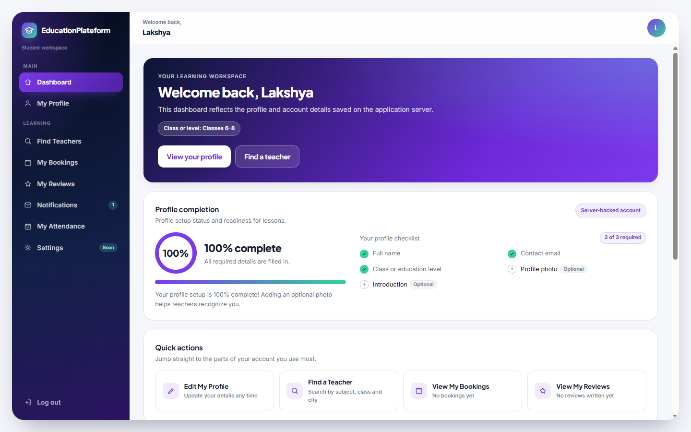</a> | <a href="https://raw.githubusercontent.com/Lakshyadev247/EducationPlatform/assets/00_student_find_teachers.png">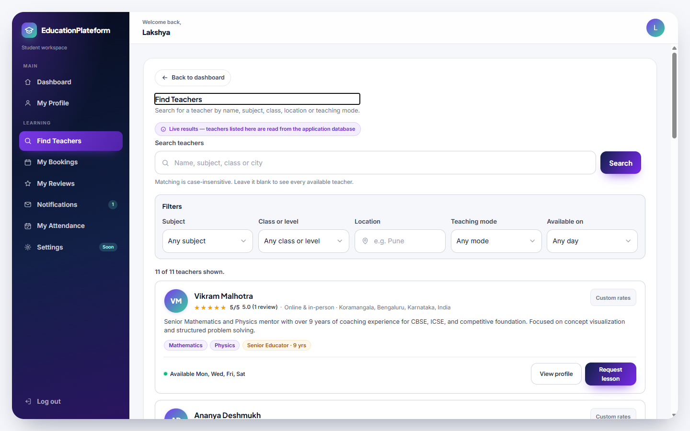</a> |
| *Personalized learning hub & 100% profile checklist* | *Search and filter verified educators by subject, level & city* |

| 👨‍🏫 2b. Teacher Public Profile | ⭐ 2c. Verified Ratings & Reviews Breakdown |
| :---: | :---: |
| <a href="https://raw.githubusercontent.com/Lakshyadev247/EducationPlatform/assets/05_teacher_public_profile_with_review.png"></a> | <a href="https://raw.githubusercontent.com/Lakshyadev247/EducationPlatform/assets/06_teacher_ratings_and_reviews_focus.png">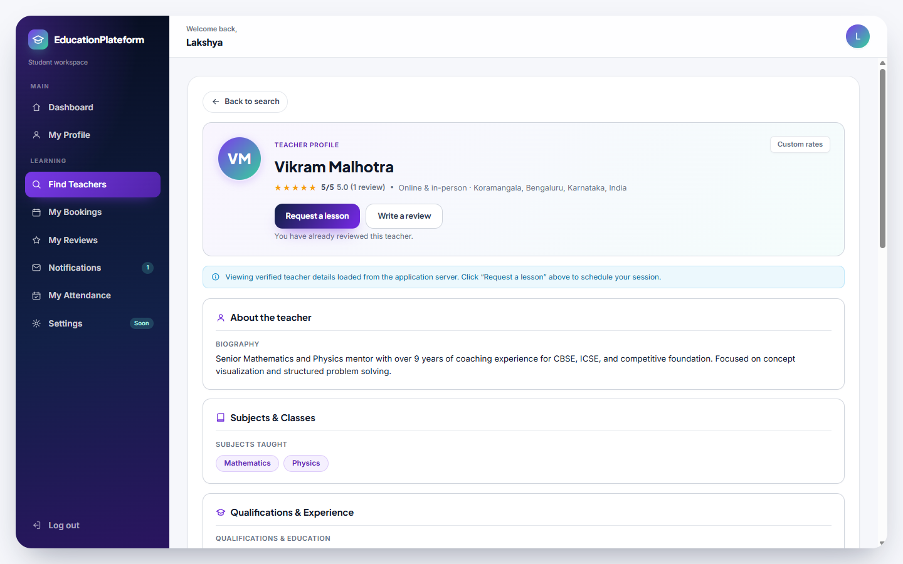</a> |
| *Educator bio, degrees, coaching experience & rates* | *Star distribution and verified student feedback* |

| 📅 3. My Bookings | ✍️ 4. My Reviews |
| :---: | :---: |
| <a href="https://raw.githubusercontent.com/Lakshyadev247/EducationPlatform/assets/04_student_my_bookings_completed.png">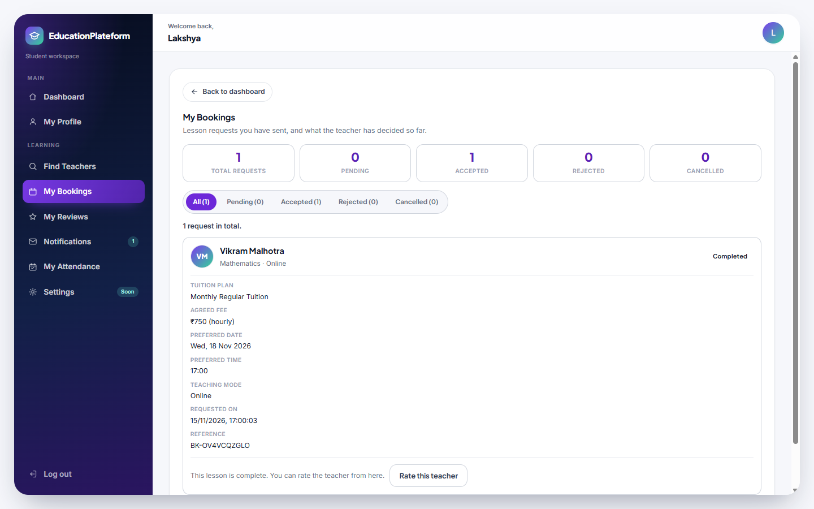</a> | <a href="https://raw.githubusercontent.com/Lakshyadev247/EducationPlatform/assets/01_student_my_reviews.png">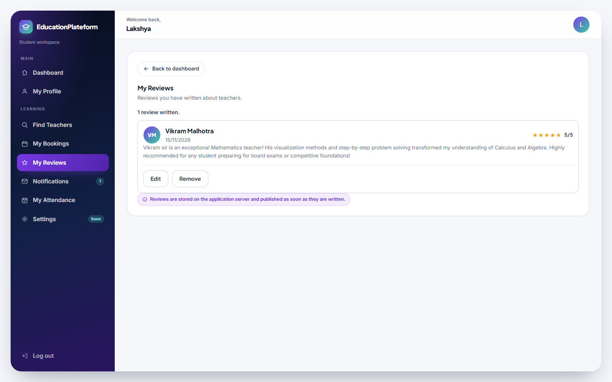</a> |
| *Completed tuition requests with reference tracking* | *Review management, star ratings, and moderation status* |

| 🔔 5. Notifications | 📋 6. My Attendance |
| :---: | :---: |
| <a href="https://raw.githubusercontent.com/Lakshyadev247/EducationPlatform/assets/03_student_notifications.png">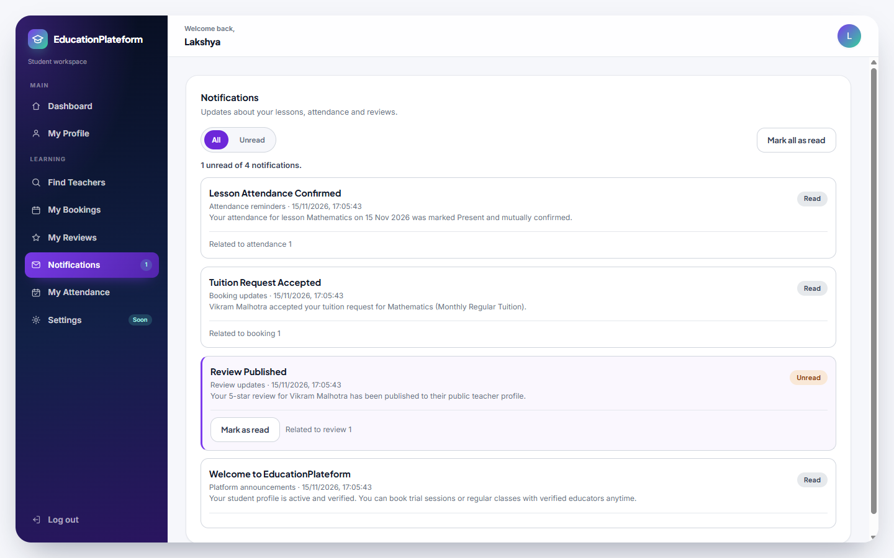</a> | <a href="https://raw.githubusercontent.com/Lakshyadev247/EducationPlatform/assets/02_student_my_attendance.png">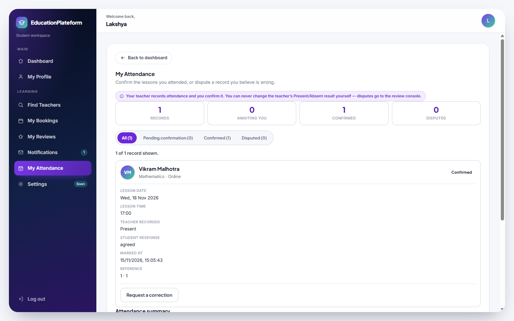</a> |
| *Real-time booking and lesson confirmation alerts* | *Mutual attendance confirmation and dispute log* |

---

### 2. Teacher Workspace (Navigation: Top to Bottom)

| 📊 1. Dashboard | 👤 2. My Profile |
| :---: | :---: |
| <a href="https://raw.githubusercontent.com/Lakshyadev247/EducationPlatform/assets/07_teacher_dashboard.png">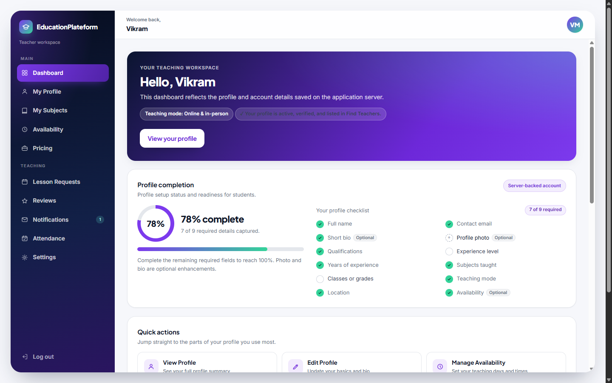</a> | <a href="https://raw.githubusercontent.com/Lakshyadev247/EducationPlatform/assets/08_teacher_my_profile.png">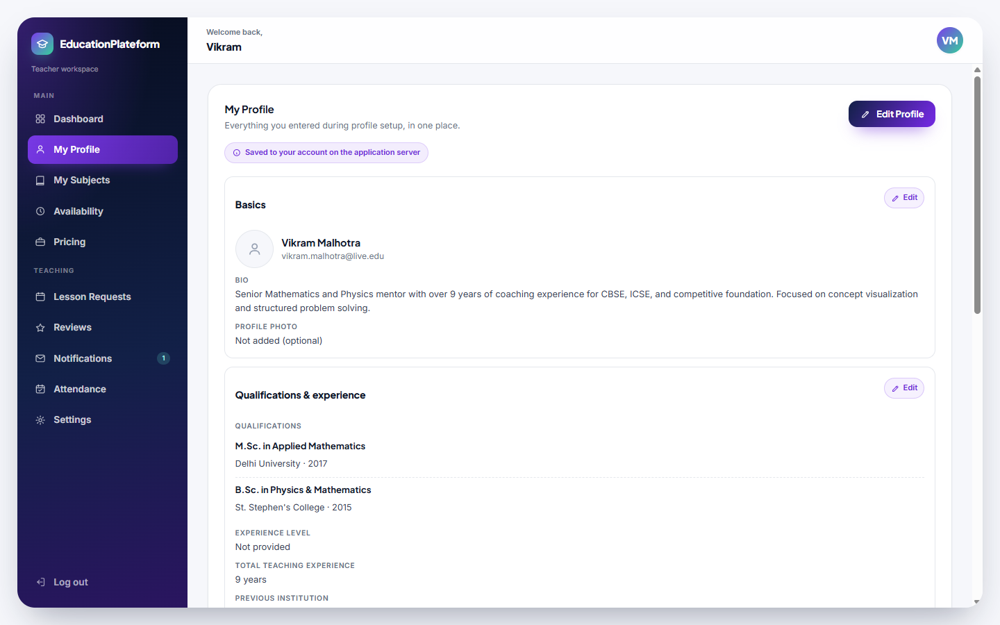</a> |
| *Educator hub, profile readiness & active statistics* | *Bio, university degrees & verification badging* |

| 📚 3. Teaching Subjects | ⏰ 4. Availability & Hours |
| :---: | :---: |
| <a href="https://raw.githubusercontent.com/Lakshyadev247/EducationPlatform/assets/14_teacher_my_subjects.png">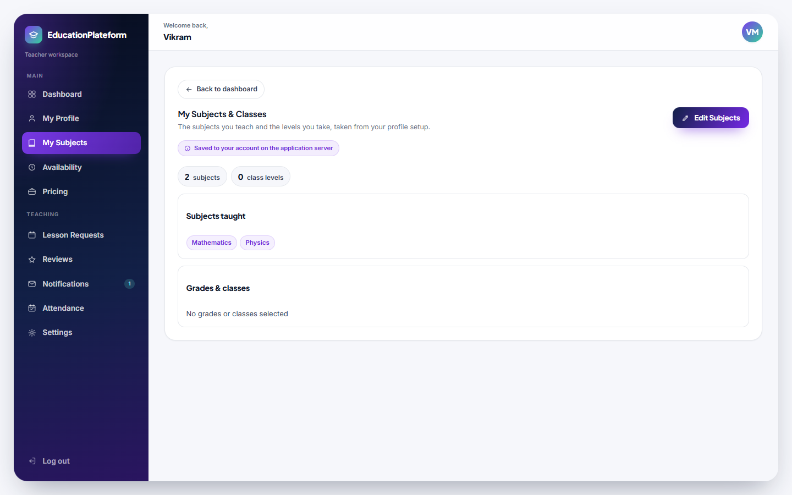</a> | <a href="https://raw.githubusercontent.com/Lakshyadev247/EducationPlatform/assets/15_teacher_availability.png">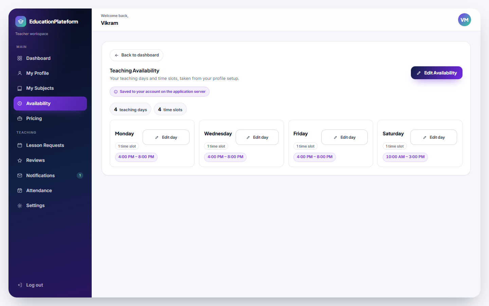</a> |
| *Subject catalog & target class grade level bands* | *Weekly teaching schedule matrix and bookable hours* |

| 💰 5. Pricing & Rates | 📩 6. Lesson Requests |
| :---: | :---: |
| <a href="https://raw.githubusercontent.com/Lakshyadev247/EducationPlatform/assets/09_teacher_pricing.png">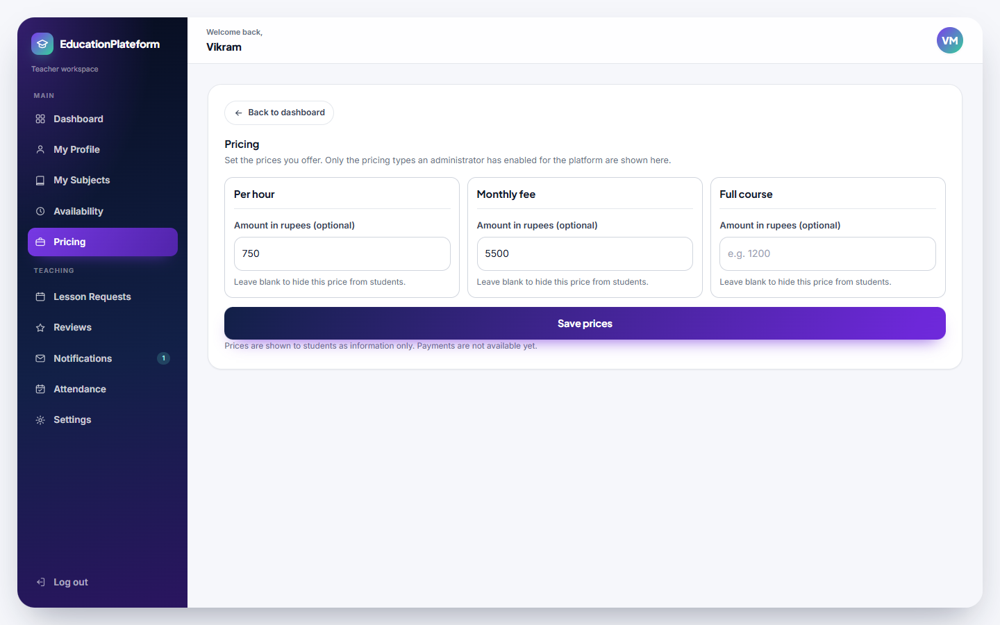</a> | <a href="https://raw.githubusercontent.com/Lakshyadev247/EducationPlatform/assets/10_teacher_lesson_requests.png">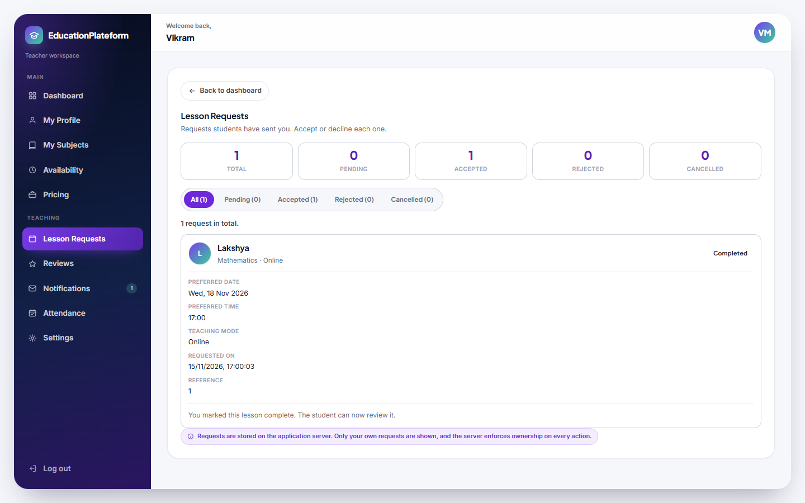</a> |
| *Hourly rates, monthly tuition & package pricing* | *Incoming student tuition requests & action pipeline* |

| 📝 7. Attendance | 🌟 8. Reviews |
| :---: | :---: |
| <a href="https://raw.githubusercontent.com/Lakshyadev247/EducationPlatform/assets/12_teacher_attendance.png">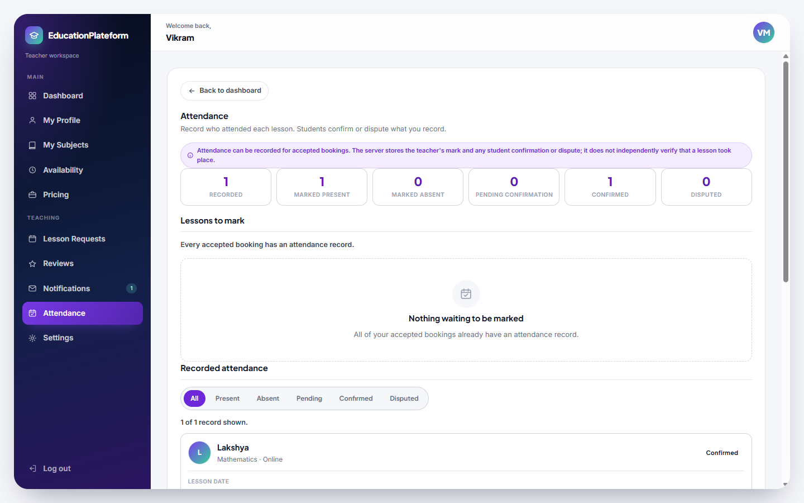</a> | <a href="https://raw.githubusercontent.com/Lakshyadev247/EducationPlatform/assets/11_teacher_reviews.png">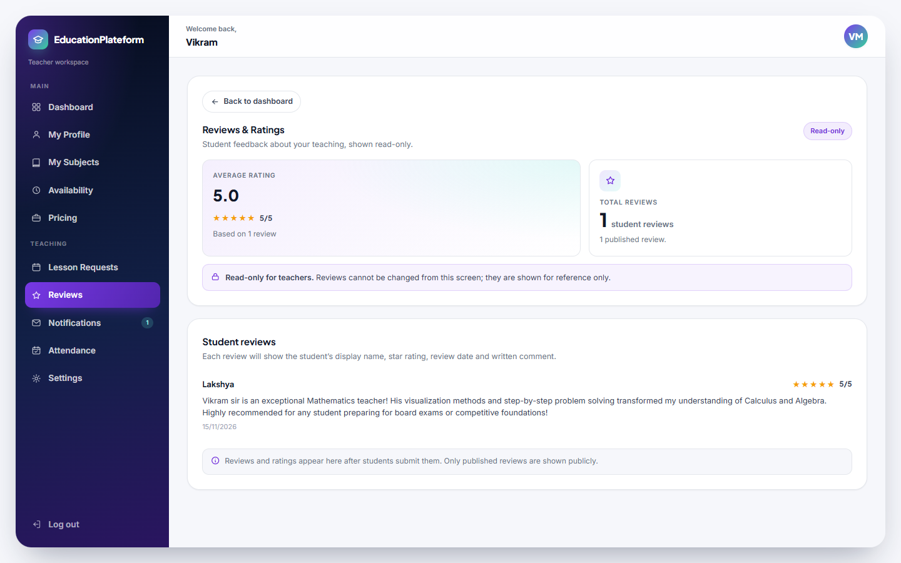</a> |
| *Mark sessions Present/Absent/Cancelled with notes* | *Verified student review aggregation & average rating* |

| 🔔 9. Notifications | |
| :---: | :---: |
| <a href="https://raw.githubusercontent.com/Lakshyadev247/EducationPlatform/assets/13_teacher_notifications.png">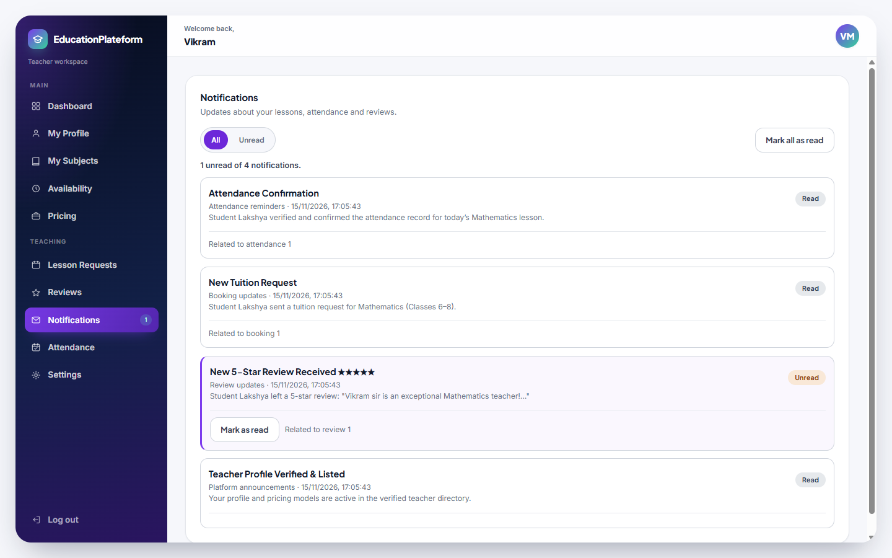</a> | *(End of Teacher Navigation)* |
| *Live lesson requests, attendance & review alerts* | |

---

### 3. Admin Control Center (Navigation: Top to Bottom)

| 📈 1. Overview | 👩‍🏫 2. Teacher Management |
| :---: | :---: |
| <a href="https://raw.githubusercontent.com/Lakshyadev247/EducationPlatform/assets/16_admin_overview.png">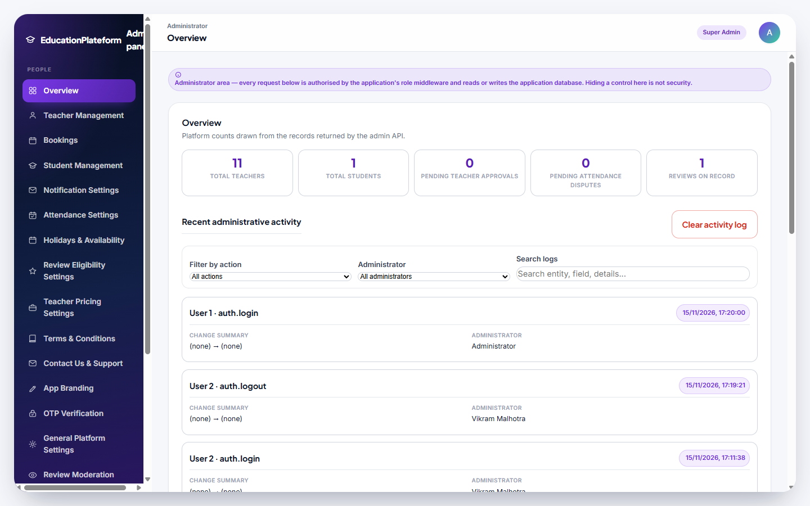</a> | <a href="https://raw.githubusercontent.com/Lakshyadev247/EducationPlatform/assets/26_admin_teacher_management.png">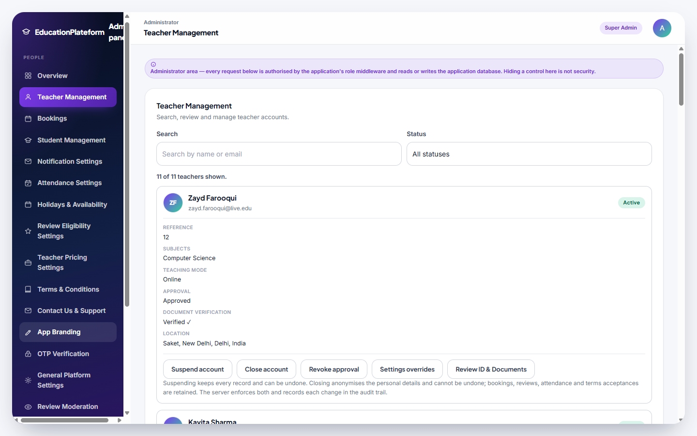</a> |
| *Platform KPIs, booking metrics & system status* | *Teacher directory, verification status & rate controls* |

| 🎓 3. Student Management | 📑 4. Bookings |
| :---: | :---: |
| <a href="https://raw.githubusercontent.com/Lakshyadev247/EducationPlatform/assets/17_admin_student_management.png">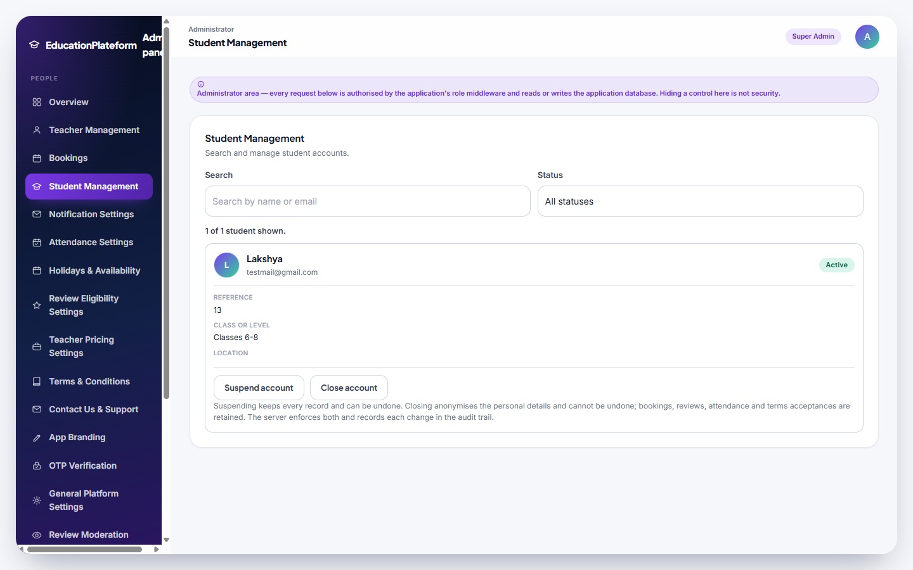</a> | <a href="https://raw.githubusercontent.com/Lakshyadev247/EducationPlatform/assets/18_admin_bookings.png">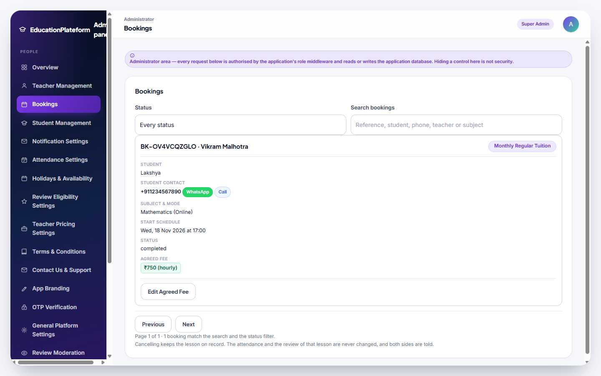</a> |
| *Student directory, grade levels & account status* | *Global bookings monitor across all teachers* |

| ⚖️ 5. Review Moderation | ⏱️ 6. Attendance Settings |
| :---: | :---: |
| <a href="https://raw.githubusercontent.com/Lakshyadev247/EducationPlatform/assets/19_admin_review_moderation.png">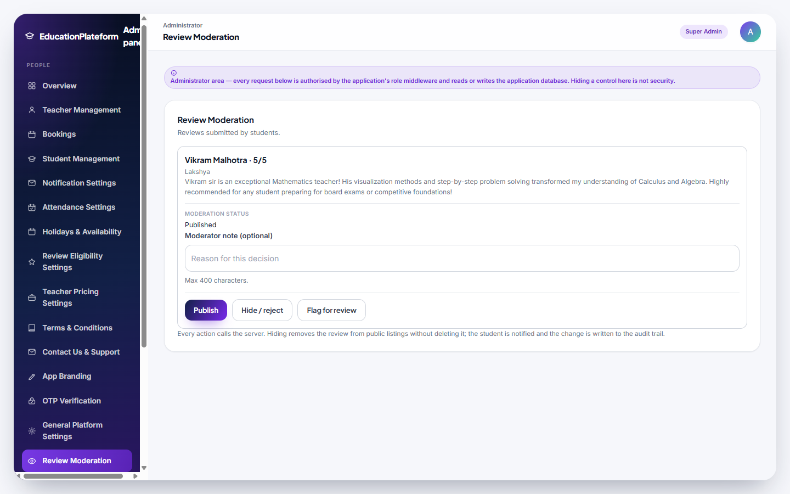</a> | <a href="https://raw.githubusercontent.com/Lakshyadev247/EducationPlatform/assets/20_admin_attendance_settings.png">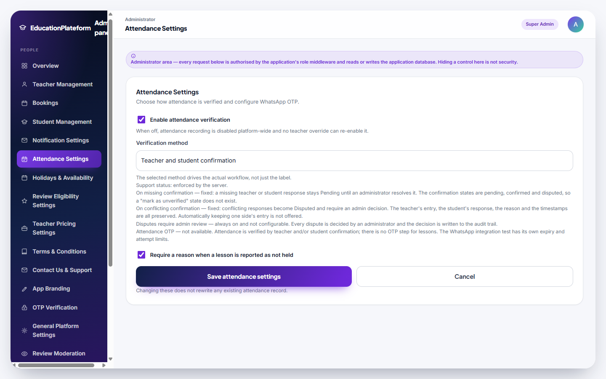</a> |
| *Moderation queue to approve, reject or edit reviews* | *Mutual sign-off policy & absence explanation rules* |

| 🛡️ 7. Review Eligibility Settings | 💵 8. Teacher Pricing Settings |
| :---: | :---: |
| <a href="https://raw.githubusercontent.com/Lakshyadev247/EducationPlatform/assets/21_admin_review_eligibility_settings.png">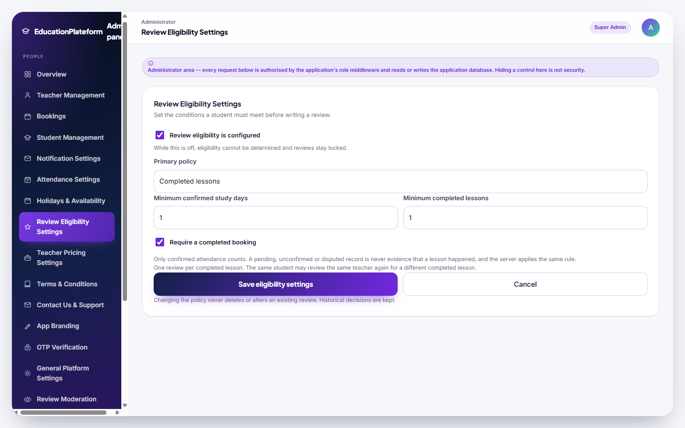</a> | <a href="https://raw.githubusercontent.com/Lakshyadev247/EducationPlatform/assets/22_admin_teacher_pricing_settings.png">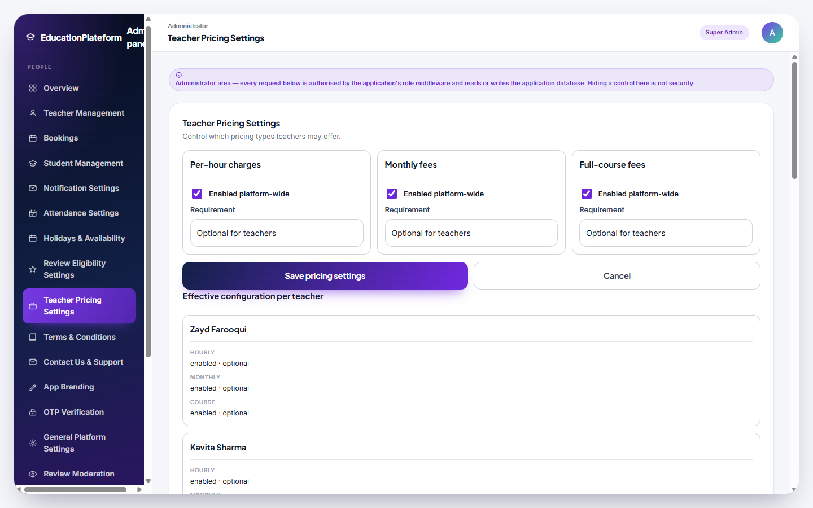</a> |
| *Milestone threshold rules (completed lessons / days)* | *Enforce or allow hourly, monthly, or course rates* |

| 📜 9. Terms & Conditions | 🎨 10. App Branding |
| :---: | :---: |
| <a href="https://raw.githubusercontent.com/Lakshyadev247/EducationPlatform/assets/23_admin_terms_and_conditions.png">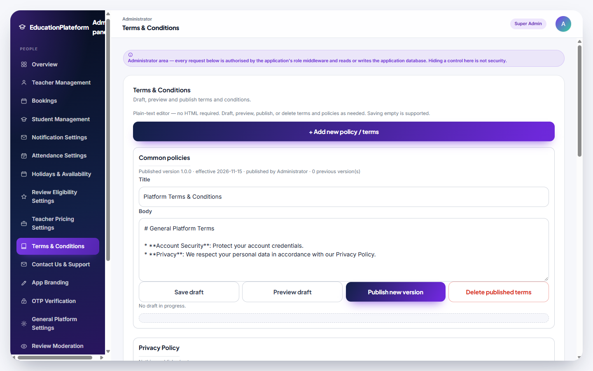</a> | <a href="https://raw.githubusercontent.com/Lakshyadev247/EducationPlatform/assets/24_admin_app_branding.png">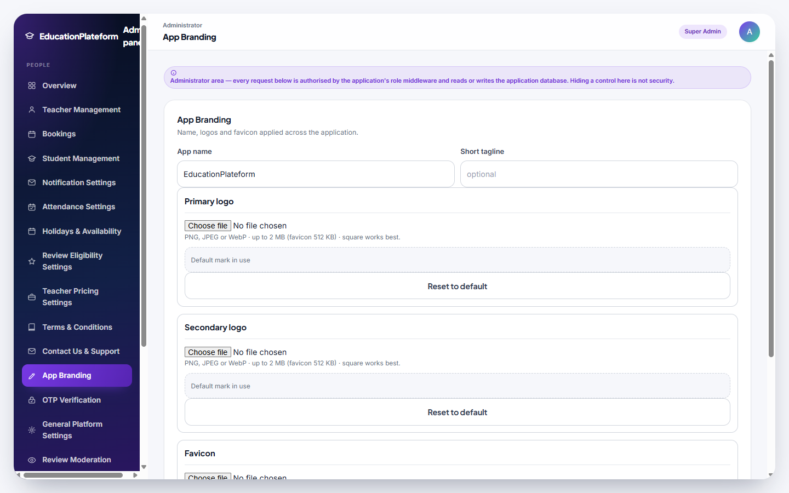</a> |
| *Multi-audience draft/publish versioning manager* | *Dynamic live brand title, tagline, logo & favicon* |

| 💾 11. Data & Backups | |
| :---: | :---: |
| <a href="https://raw.githubusercontent.com/Lakshyadev247/EducationPlatform/assets/25_admin_data_and_backups.png">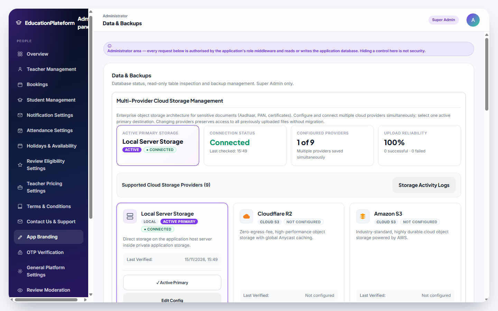</a> | *(End of Admin Navigation)* |
| *Automated backups, table browser & token restore* | |

---

## 🚀 Feature Breakdown

### Teacher-Side Features
1. **Educator Onboarding**: Profile bio, qualifications, university degrees, and experience level.
2. **Flexible Teaching Modes**: Specify Online, In-person, or Hybrid teaching with service radius.
3. **Availability Scheduler**: Define exact bookable time slots for each weekday.
4. **Independent Pricing**: Publish hourly rates, monthly regular tuition packages, or course fees.
5. **Booking Management**: Accept, reject, or mark lessons completed with unique tracking IDs.
6. **Attendance Logging**: Record lesson attendance (Present/Absent/Cancelled) with session summaries.
7. **Reputation & Review Hub**: Transparent feedback tracking with verified student ratings.
8. **Credential Upload**: Upload identity and degree certificates for verification badging.

### Student-Side Features
1. **Learner Onboarding**: Grade level selection, learning goals, and contact details.
2. **Directory & Search Filters**: Search teachers by subject, grade level, location/city, teaching mode, and weekday availability.
3. **Transparent Public Profiles**: Review teacher qualifications, experience, verified student testimonials, and pricing cards.
4. **Tuition Booking Engine**: Select tuition plan, subject, and match dates against teacher's available slots.
5. **My Bookings Tracker**: Real-time status tracking for pending, accepted, and completed lessons.
6. **Mutual Attendance Confirmation**: One-click confirmation or dispute raising for logged lessons.
7. **Protected Reviews**: Submit 1–5 star reviews and written testimonials once eligible.

### Admin Settings & Governance
1. **General Controls**: Toggle student signup, teacher signup, new bookings, teacher approval requirement, and maintenance mode.
2. **Attendance Policy**: Select verification method (`teacher-and-student` vs `teacher-only`) and enforce absence reasons.
3. **Review Eligibility Rules**: Configure eligibility milestones (`completed-lessons` or `study-days`).
4. **Teacher Pricing Directives**: Enable/disable hourly, monthly, and course pricing tiers; enforce mandatory pricing modes.
5. **White-Label Branding**: Live platform name, tagline, logo, and favicon customization.
6. **Holiday Management**: Define public/school holidays and block lesson bookings on holiday dates.
7. **Data & Backups**: Automated daily backups, retention auto-cleanup, database table browser, and token-gated restore.
8. **Audit Trail**: Immutable record of all administrative configuration changes and security events.

---

## ⚙️ Admin Settings Impact Matrix

| Setting Group | Setting Key | Impact on Teachers | Impact on Students |
| :--- | :--- | :--- | :--- |
| **General** | `teacherSignup` | Disables new teacher registrations when toggled OFF. | N/A |
| **General** | `supportSignup` | N/A | Disables new student account registrations. |
| **General** | `newBookingsAccepted` | Disables incoming lesson booking requests. | Deactivates "Request Lesson" buttons across all profiles. |
| **General** | `teacherApprovalRequired` | Hides teacher from directory until approved by admin. | Only verified, approved teachers appear in search. |
| **Attendance** | `verificationMethod` | If `teacher-and-student`, logs can be disputed by students. | Students receive action prompt to agree or dispute attendance. |
| **Attendance** | `requireReasonWhenLessonMissed` | Enforces explanation when marking a student absent. | Enforces explanation if student disputes session. |
| **Eligibility** | `eligibility.type` & thresholds | Protects teacher ratings from unverified reviews. | Unlocks "Write a Review" only after required lessons/days. |
| **Pricing** | `pricing.*.mode` | Enforces mandatory hourly or monthly rate publication. | Guarantees clear, transparent rates on teacher profiles. |
| **Holidays** | `blockNewBookings` | Prevents lessons from being scheduled on holidays. | Disallows booking dates matching registered holidays. |
| **Branding** | `branding.appName` / `logo` | Reflects brand identity in teacher workspace and emails. | Reflects brand identity across student dashboard. |

---

## 🛠️ Getting Started

### Prerequisites
- **PHP**: >= 8.2 with `pdo`, `mbstring`, `openssl`, `tokenizer`, `xml`, `ctype`, `json`, `curl`
- **Composer**: Dependency manager for PHP
- **Database**: SQLite (default / zero-config) or MySQL 8.0+

### Installation Steps

1. **Clone the repository**:
   ```bash
   git clone https://github.com/Lakshyadev247/EducationPlatform.git
   cd EducationPlatform
   ```

2. **Setup backend environment**:
   ```bash
   cd backend
   composer install
   cp .env.example .env
   php artisan key:generate
   ```

3. **Run database migrations and seed baseline configurations**:
   ```bash
   php artisan migrate --seed
   ```

4. **Start the local development server**:
   ```bash
   php artisan serve --port=8000
   ```

5. **Access the application**:
   - Open your browser at `http://127.0.0.1:8000` (or open the root `index.html` via any local static server).
   - Baseline seeders create standard administrative roles and default platform settings.

---

## 📂 Directory Structure

```
EducationPlatform/
├── assets/                    # Frontend client assets
│   ├── css/                   # Stylesheets & themes
│   └── js/                    # Application logic (SPA router, auth, views)
├── backend/                   # Laravel REST API backend
│   ├── app/
│   │   ├── Http/Controllers/  # Auth, Student, Teacher, and Admin controllers
│   │   ├── Models/            # Eloquent data models
│   │   └── Services/          # Settings schema, backups, audit logging
│   ├── config/                # Framework & package configurations
│   ├── database/
│   │   ├── factories/         # Model factories
│   │   ├── migrations/        # Database schema definitions
│   │   └── seeders/           # Initial role, reference data, and settings seeders
│   └── routes/
│       └── api.php            # Versioned API routes (/api/v1/...)
├── index.html                 # Single Page Application entry point
└── README.md                  # Project documentation & showcases
```

---

## 🛡️ Security & Clean Packaging

This repository follows strict open-source standards:
- **Zero Database Artifacts**: Contains **no** `.sqlite`, `.db`, `.sql`, or backup dumps.
- **Zero Secrets**: Contains `.env.example` templates; local secrets and keys are strictly excluded.
- **Brand Neutral**: All user-facing brand assets, names, and contact channels are configured live through the Admin Branding interface.

---

## 📦 Releases

Download clean production-ready standalone distribution archives from the [Releases](https://github.com/Lakshyadev247/EducationPlatform/releases) page.
